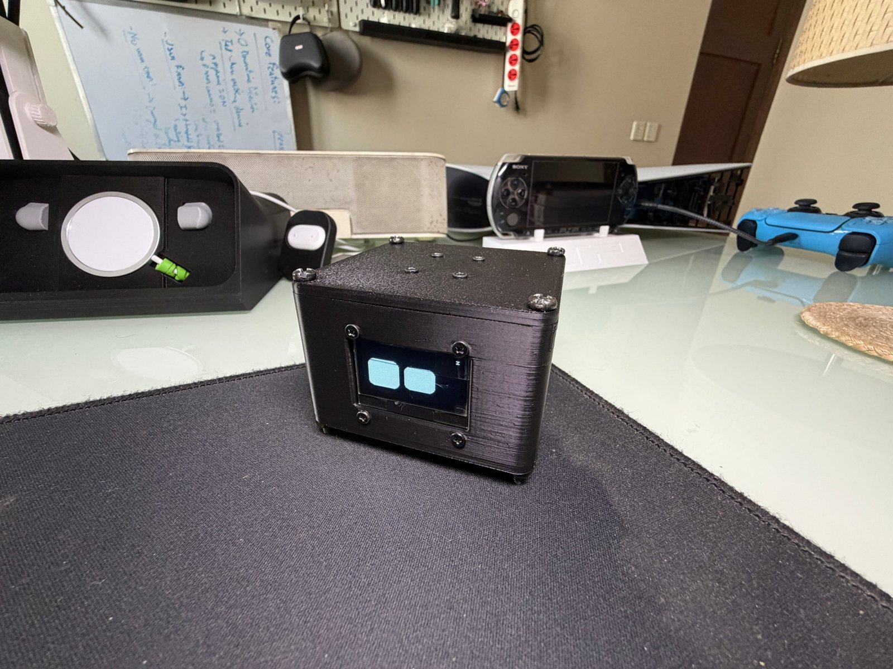
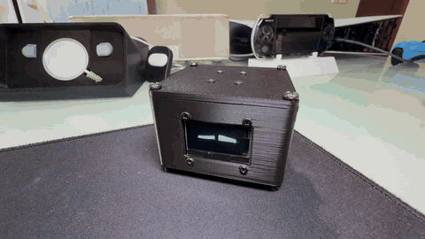
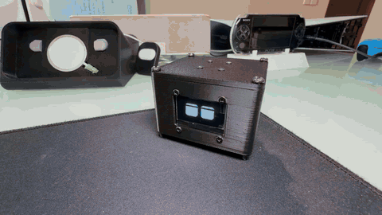
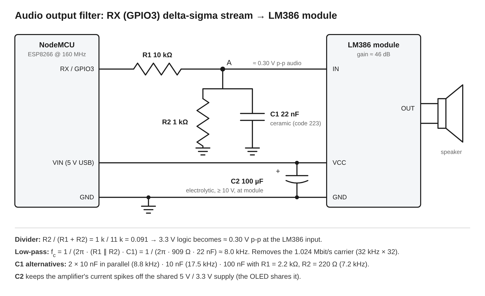

# OLED Desktop Pet

A small, fully offline desktop pet: animated eyes on a 1.3" OLED that drift through moods on their own,
light up when you pet a hidden touch pad, and start sulking (and asking out loud) when ignored.



| Petting: glee + purr | Mute: hold 5 s |
|---|---|
|  |  |
| [▶ video with sound](docs/media/petting.mp4) | [▶ video with sound](docs/media/mute.mp4) |

## Features

- **60 fps procedural eyes.** 18 expressions drawn from parameters (no bitmaps), eased transitions,
  random blinking (with occasional double blinks) and wandering gaze.
- **Touch to pet, no exposed electrodes.** A capacitive sensor senses through the printed lid.
  Touching snaps the face to glee within ~150 ms and starts a purr.
- **Mood driven by attention.**

  | Time since last pet | State | Faces |
  |---|---|---|
  | while touching | Petted | Glee |
  | 0–3 min | Content | Happy, Normal, Sleepy |
  | 3–5 min | Regular | Curious mix (Skeptic, Focused, Suspicious, Surprised …), faster gaze |
  | > 5 min | Neglected | No positive faces; Sad / Worried / Angry share grows 40 % → 90 % by 20 min |

- **Sound.** Boot chirp, happy chirp + purr on touch, content blips, curious "hm?", escalating whines,
  and a spoken **"pet me"** ([listen](docs/media/pet_me.wav)) at most once every 5 min when neglected.
- **Mute.** Hold the pad 5 s to toggle (floating "z Z z" to confirm; a small "z" stays in the corner).
- **Always offline.** Wi-Fi is switched off at boot.

## Hardware

| Part | Notes |
|---|---|
| ESP8266 NodeMCU (ESP-12E) | Run at **160 MHz** |
| 1.3" OLED, 128×64, **SH1106**, 4-wire SPI | 7-pin module |
| Adafruit AT42QT1010 capacitive touch breakout ([#1374](https://www.adafruit.com/product/1374)) | Mounted against the inside of the lid |
| LM386 speaker module | Powered from 5 V |
| 10 kΩ, 1 kΩ resistors; 22 nF ceramic; 100 µF electrolytic | Audio filter and amp decoupling |
| 3D-printed enclosure | 70 × 74 × 48 mm; STL and Fusion source in [`hardware/enclosure`](hardware/enclosure) |

Full list: [`hardware/BOM.md`](hardware/BOM.md). Wiring and pin map: [`hardware/WIRING.md`](hardware/WIRING.md).



## Build and flash

1. Arduino IDE with the **ESP8266 core** (tested with 3.1.2) and the **U8g2** library (Library Manager).
2. Open `firmware/desktop_pet/desktop_pet.ino`.
3. **Tools → Board → NodeMCU 1.0 (ESP-12E Module)**, **Tools → CPU Frequency → 160 MHz**.
4. Upload. Behaviour, timings, volume and pins are all in `firmware/desktop_pet/PetConfig.h`.

Serial (115200 baud, transmit-only because RX is the audio pin) prints a status line every 5 s:

```
fps=60.0  frame avg=4582 us  max=5026 us  budget=16666 us  state=CONTENT  audio_underflows=0
```

### Bring-up tests

| Sketch | Checks |
|---|---|
| `tests/oled_driver_test` | Display controller and wiring. Border must touch all four edges. |
| `tests/speaker_test` | Amplifier, filter and the I2S audio path; prints CPU cost and buffer underflows. |

## How it works

**Display.** U8g2 full-frame buffer over hardware SPI at 8 MHz. A frame (render + transfer) takes
~4.6 ms of the 16.7 ms budget at 60 fps.

**Eyes.** Adapted from [esp32-eyes](https://github.com/playfultechnology/esp32-eyes). Changes: SH1106 over
SPI; expression transitions rewritten to interpolate from a fixed start snapshot with smoothstep easing
(the original blended in place each frame, so speed depended on frame rate and small changes stalled then
snapped); eased gaze; a fixed 60 fps scheduler with randomised blink, gaze and mood timers.

**Touch.** The QT1010 output is on D6 (GPIO12), which is also hardware-SPI MISO. `SPI.begin()` claims that
pin, so the input is configured *after* the display starts. The display is write-only, so this is safe.

**Audio without a DAC.** The ESP8266's I2S peripheral streams a **2nd-order 1-bit delta-sigma** signal at
32 kHz × 32 oversampling on GPIO3 only; an RC low-pass turns it back into analog for the LM386.
ESP8266Audio's no-DAC output was not used because it also claims GPIO15, the OLED chip-select.

| Measured (160 MHz) | Value |
|---|---|
| Encoder + oscillator cost | 4.96 µs per sample = 16 % CPU while a sound plays (0 % when idle) |
| Simulated in-band SNR | ~70 dB (vs ~30–37 dB for the 1st-order encoder it replaced) |
| Buffer underflows | 0 |

**"Pet me".** Speech is synthesised with [SAM](https://github.com/earlephilhower/ESP8266SAM) *at build
time* on the host and stored in flash, so speaking never stalls the animation. Stressed phonemes and SAM's
aspirated "P" (`P/HEH5T, MIY4`) made "pet" intelligible. Regenerate with
`tools/sam_render/render_pet_me.sh` (override with `PHONEMES=` / `PARAMS=`).

## Repository layout

```
firmware/desktop_pet/   Arduino sketch (eyes engine, PetAudio, behaviour, config)
tests/                  Bring-up sketches (display, speaker)
tools/sam_render/       Host renderer that regenerates pet_me.h from SAM
hardware/               Wiring, schematic, bill of materials, enclosure (STL + Fusion)
docs/media/             Photos, demo videos, "pet me" audio sample
```

## Credits and license

- Eye engine: [playfultechnology/esp32-eyes](https://github.com/playfultechnology/esp32-eyes)
  (Alastair Aitchison), based on Luis Llamas' ESP32_Faces.
- Speech: [ESP8266SAM](https://github.com/earlephilhower/ESP8266SAM) (Earle F. Philhower III), a port of
  Software Automatic Mouth.
- Display driver: [U8g2](https://github.com/olikraus/u8g2) (Oliver Kraus).

Released under the GNU General Public License v3.0 (see [`LICENSE`](LICENSE)), as required by the
esp32-eyes code it builds on. Individual upstream files keep their original headers, some of which
reference the GNU Affero GPL v3.
