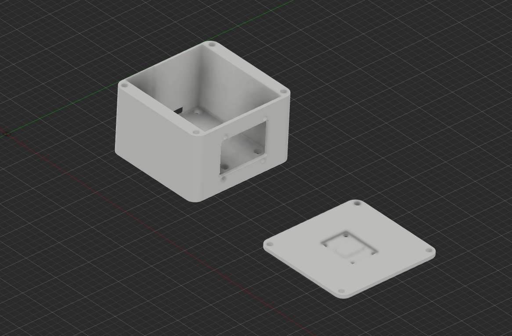
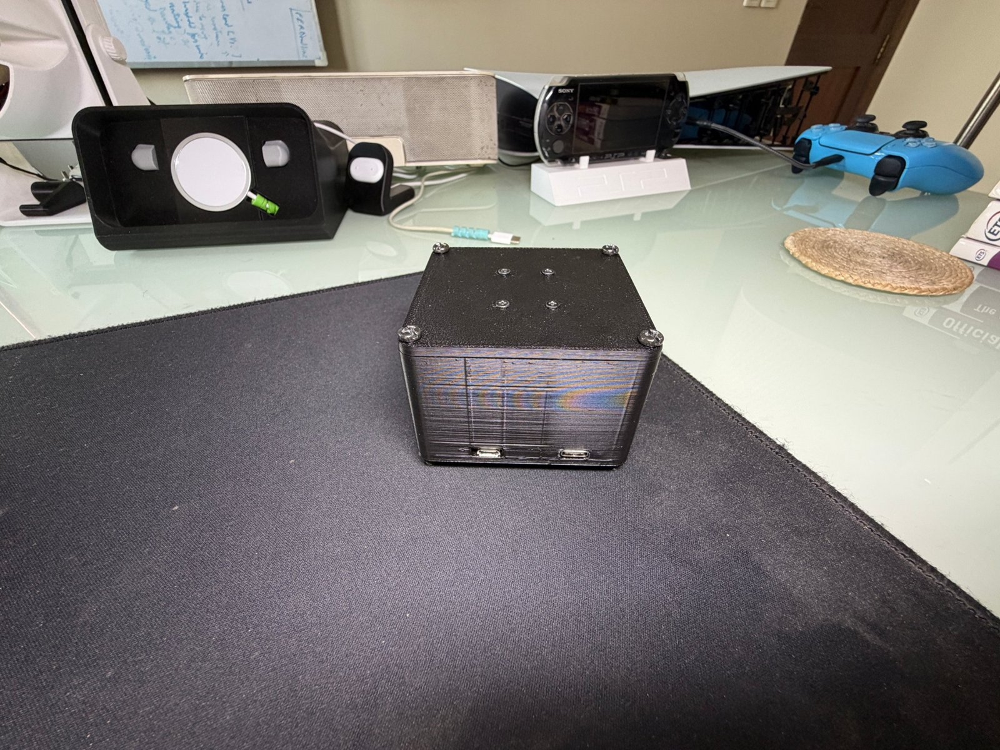

# Enclosure

| File | Part | Size (mm) |
|---|---|---|
| `body.stl` | Body: NodeMCU, speaker module and power input on the floor; OLED window in the front wall; ports in the rear wall | 70.3 × 74.0 × 45.0 |
| `lid.stl` | Screw-on lid; the touch sensor sits in a pocket on its inside face | 70.3 × 74.0 × 3.0 |
| `desktop_pet_housing.f3d` | Autodesk Fusion source for both parts | |

The STLs are oriented as modelled: body open side up, lid outer face down. The body floor and the lid are 3 mm thick.

## Design notes

- **Touch through the lid.** The AT42QT1010 board sits in a 27.5 × 20 mm pocket on the lid's inside face,
  1.5 mm deep, leaving **1.5 mm of plastic** between the sensor and your finger. The board must sit flat
  against the pocket floor: an air gap kills sensitivity.
- **Display window.** The OLED mounts from the front behind a screwed bezel (4 screws), with the
  window sized to the panel's active area.
- **Fasteners.** 4 screws hold the lid to the body; 4 more hold the touch sensor to the lid.
- **Rear wall.** Cut-outs for the NodeMCU's USB port (flashing and serial) and the power input.

